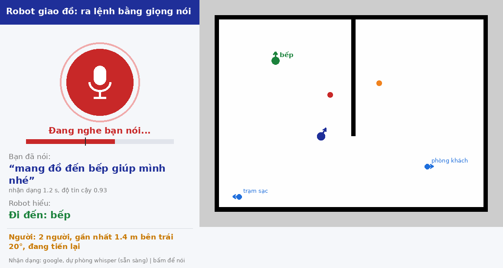

# TB4 VoiceNav: phần cảm nhận (giọng nói và nhận diện người)

Phần của đề tài robot giao đồ TurtleBot 4 do mình phụ trách: **hiểu lệnh nói tiếng Việt**
và **nhận diện người bằng camera OAK-D**. Package chỉ phát kết quả lên topic ROS 2; phần
điều hướng, dừng và cảnh báo do người làm thực thi đảm nhiệm. Định dạng message nằm trong
[INTERFACE.md](INTERFACE.md).

Muốn chạy từ đầu (vẽ map, đánh dấu điểm đến, cho robot đi): xem
[Từ vẽ map đến lúc robot đi](#từ-vẽ-map-đến-lúc-robot-đi-làm-theo-thứ-tự).

```
Micro → VAD → nhận dạng (Google, Whisper dự phòng | Vosk) → /speech_text → bộ hiểu lệnh → /voice_command
OAK-D RGB + depth → YOLOv8n (người) + khoảng cách + góc ──────────────────→ /person_detections
```

## Cấu trúc

```
voice_person_perception/            package ROS 2 (ament_python)
├── config/destinations.yaml        điểm đến, cách nói khác và vị trí trên map (dùng chung)
├── config/eval_phrases.yaml        câu thử cho eval_voice
├── launch/perception.launch.py     chạy thật: micro + camera
├── launch/fake.launch.py           giả lập cho bên thực thi test khi chưa có robot
├── launch/record_bag.launch.py     thu đầu ra thành rosbag để gửi người khác
├── voice_person_perception/
│   ├── intent.py, vad.py, person_math.py, asr_backends.py   logic thuần, có test
│   ├── vocab.py, waypoints.py, marker_specs.py              logic thuần, có test
│   ├── asr_node.py, intent_resolver_node.py, person_detector_node.py
│   ├── waypoint_marker.py          đánh dấu điểm đến trên map, ghi vào destinations.yaml
│   ├── destination_markers.py      vẽ các điểm đến lên RViz, tự cập nhật khi file đổi
│   ├── voice_gui.py, gui_render.py giao diện: nút nói, lệnh đã hiểu, bản đồ/radar người
│   ├── eval_voice.py               đo độ chính xác + độ trễ giọng nói
│   └── fake_voice_node.py, fake_person_node.py
└── test/                           pytest, không cần ROS
```

## Cài đặt

Ubuntu 22.04, ROS 2 Humble.

```bash
cd ~/ros2_ws/src && git clone <repo này> && cd ..
pip install -r requirements.txt      # đã ghim numpy<2, opencv<4.12 cho ROS Humble
sudo apt install portaudio19-dev            # cho sounddevice
colcon build --packages-select voice_person_perception
source install/setup.bash
```

Nhận dạng giọng nói: mặc định **Google** (cần Internet), **Whisper** dự phòng.

- **Google** (`backend:=google`): dùng gói `SpeechRecognition`, gửi từng câu lên Google, tiếng Việt
  tốt nhất trong ba bộ. Google trả vài phương án; node chọn phương án đầu tiên có tên một điểm đến
  trong `destinations.yaml`, không có thì lấy phương án đầu.
- **Whisper dự phòng** (`fallback:=whisper`): chỉ chạy khi Google báo lỗi (mất mạng, hết hạn mức,
  quá 5 s), và chỉ cho câu đó. Google nghe không ra chữ thì KHÔNG chuyển, để tránh tốn thời gian.
  Model Whisper được tải và nạp ở nền (lần đầu khoảng 500 MB), Google dùng được ngay; log báo
  `whisper dự phòng đã sẵn sàng` khi xong. Nên tải trước một lần, có thanh tiến độ:
  `python3 -c "from faster_whisper import WhisperModel; WhisperModel('small', compute_type='int8')"`.
  Chạy trên laptop.
  Có thể trỏ `whisper_model:=` tới một thư mục model CTranslate2, ví dụ PhoWhisper (Whisper huấn
  luyện thêm cho tiếng Việt).
- **Vosk** (`backend:=vosk`, offline, hợp Raspberry Pi): `bash scripts/download_vosk_model.sh` tải
  `vosk-model-small-vn-0.4` về `models/`. Nhận tiếng Việt kém hơn hai bộ trên.

YOLOv8n (`yolov8n.pt`) được `ultralytics` tự tải lần đầu chạy.

## Chạy

```bash
# Chạy thật (cần micro, Internet, và camera OAK-D đang phát topic):
ros2 launch voice_person_perception perception.launch.py           # Google, Whisper dự phòng
ros2 launch voice_person_perception perception.launch.py whisper_model:=medium
ros2 launch voice_person_perception perception.launch.py fallback:=none   # chỉ Google

# Giả lập (không cần micro/camera):
ros2 launch voice_person_perception fake.launch.py
```

### Giao diện (`voice_gui`)



```bash
# Laptop, chưa có camera: giọng nói + giao diện, bấm nút để nói
ros2 launch voice_person_perception perception.launch.py person:=false gui:=true push_to_talk:=true
# Có bản đồ: vẽ thêm điểm đến, vị trí robot và người lên bản đồ
ros2 launch voice_person_perception perception.launch.py gui:=true push_to_talk:=true \
    map_yaml:=$HOME/maps/lab.yaml destinations_file:=$DEST
# Xem dữ liệu giả
ros2 launch voice_person_perception fake.launch.py gui:=true
```

- **Trái:** nút micro (xám: bấm để nói; đỏ: đang nghe; vàng: đang nhận dạng), mức âm lượng so với
  ngưỡng (vạch đen), câu vừa nghe, lệnh robot hiểu (xanh: đi luôn; vàng: cần xác nhận; đỏ: dừng),
  tóm tắt người phía trước, bộ nhận dạng đang dùng.
- **Phải:** có `map_yaml` thì là bản đồ với điểm đến (xanh lá: đang tới), robot và người (cần
  SLAM/AMCL để có vị trí robot); không có thì là radar người quanh robot (0,5 / 1 / 2 / 3 m).
- Bấm nút hoặc phím **Space** rồi nói một câu. Câu kết thúc khi im 1,5 s (`ptt_end_silence_ms`),
  hoặc **bấm lần nữa để gửi ngay**; bấm lại khi chưa nói gì là hủy. **Q** để đóng. Không có
  `push_to_talk:=true` thì micro nghe liên tục (câu kết thúc khi im 0,7 s, `end_silence_ms`) và
  nút dùng để tắt/bật micro.
- Nhận dạng sai nhiều: chạy thêm `save_audio_dir:=~/asr_debug` (tham số của `asr_node`). Mỗi câu
  được lưu thành WAV kèm chữ nhận được trong `log.tsv`. Nghe lại: nếu WAV rõ mà chữ sai là lỗi bộ
  nhận dạng; nếu WAV nhỏ, rè, bị cắt là lỗi micro. Câu nói nhỏ được tự khuếch đại (tối đa 8 lần,
  `normalize_audio`).
- Câu bị cắt sớm: tăng `ptt_end_silence_ms` (vd. 2000) hoặc giảm `release_ratio` (mặc định 0,6:
  giữa câu, âm to hơn 60% ngưỡng vẫn tính là đang nói). Câu dài tối đa `max_utterance_s` = 10 s.
- Giao diện chỉ hiển thị và gửi `/asr_listen`; vẫn cần `asr_node`, `intent_resolver_node`.

Tham số hay chỉnh (`--ros-args -p tên:=giá trị`):

| Node | Tham số | Mặc định | Ý nghĩa |
|---|---|---|---|
| `asr_node` | `backend` | `google` | `google`, `whisper` hoặc `vosk` |
| | `fallback` | `whisper` | Bộ dự phòng khi `backend` lỗi; `none` = không dùng |
| | `whisper_model` | `small` | Cỡ model hoặc thư mục model CTranslate2 (PhoWhisper) |
| | `model_path` | `none` | Thư mục model Vosk (khi dùng Vosk) |
| | `push_to_talk` | `false` | Chỉ nghe một câu sau mỗi lần bấm nút (`voice_gui`, `/asr_listen`) |
| | `ptt_end_silence_ms` | `1500` | Bấm-để-nói: im bao lâu thì coi là nói xong |
| | `release_ratio` | `0.6` | Giữa câu, âm trên ngưỡng × hệ số này vẫn tính là đang nói |
| | `max_utterance_s` | `10` | Câu dài nhất |
| | `normalize_audio` | `true` | Khuếch đại câu nói nhỏ trước khi nhận dạng |
| | `save_audio_dir` | `none` | Lưu từng câu ra WAV + `log.tsv` để nghe lại |
| | `device_index` | `-1` | Chỉ số micro; xem `python3 -m sounddevice` |
| | `min_rms` | `250` | Ngưỡng tiếng tối thiểu; ngưỡng thật tự theo tiếng ồn nền |
| | `vosk_grammar` | `false` | Vosk chỉ nhận câu mẫu sinh từ `destinations.yaml` (xem dưới) |
| | `whisper_prompt` | `false` | Gợi ý tên điểm đến cho Whisper (`initial_prompt`) |
| `intent_resolver_node` | `confident` | `0.97` | Điểm khớp tối thiểu để không hỏi lại |
| | `accept` | `0.75` | Dưới mức này coi là `UNKNOWN` |
| `person_detector_node` | `image_topic`, `depth_topic`, `camera_info_topic` | `/oakd/rgb/preview/...` | Topic camera; **xác nhận bằng `ros2 topic list` trên robot** |
| | `hfov_deg` | `69` | Góc nhìn ngang dùng khi không có `camera_info` |
| | `infer_rate_hz`, `imgsz` | `5`, `320` | Giảm nếu CPU yếu |

### Thiên vị nhận dạng về danh sách lệnh

Cả hai đều lấy danh sách điểm đến từ `destinations.yaml` (`voice_person_perception/vocab.py`),
bật qua launch: `vosk_grammar:=true` hoặc `whisper_prompt:=true`.

- **Vosk grammar:** chỉ nhận khoảng 300 câu mẫu ("đi đến X", "mang đồ đến X", "giao đến X", "X",
  câu dừng/hủy) hoặc `[unk]`. Chính xác hơn nhiều với tập lệnh nhỏ, nhưng câu nói ngoài mẫu sẽ bị
  ép về câu mẫu gần nhất hoặc mất chữ. Rủi ro: tên chỗ không có trong danh sách ("nhà vệ sinh")
  có thể bị nghe thành một điểm đến có thật. Cột `wrong_auto` của `eval_voice` đo đúng lỗi này.
- **Whisper prompt:** giúp Whisper viết đúng tên điểm đến; câu nào lặp lại chính prompt bị bỏ.

Mặc định tắt cả hai, bật sau khi `eval_voice` cho thấy có lợi trên giọng thật.

**Thêm bí danh theo lỗi nhận dạng:** sau khi đo, xem cột `heard` trong file kết quả. Từ nào ASR hay
nghe nhầm cho một điểm đến (ví dụ "phòng khác" thay vì "phòng khách") thì thêm vào `aliases`.

## Từ vẽ map đến lúc robot đi (làm theo thứ tự)

Laptop và robot cùng mạng, cùng `ROS_DOMAIN_ID`; mọi lệnh chạy trên laptop, mỗi lệnh một
terminal đã `source install/setup.bash`. Để gõ ngắn, đặt biến trỏ tới file điểm đến **trong
thư mục `src`** (công cụ ghi vào đây, không phải `install`):

```bash
export DEST=~/ros2_ws/src/tb4_voicenav/voice_person_perception/config/destinations.yaml
```

### Bước 1. Vẽ map và đánh dấu điểm đến cùng lúc

```bash
ros2 launch turtlebot4_navigation slam.launch.py                     # T1: vẽ map
ros2 launch turtlebot4_viz view_robot.launch.py                      # T2: RViz
ros2 run voice_person_perception destination_markers --ros-args -p file:=$DEST   # T3
ros2 run teleop_twist_keyboard teleop_twist_keyboard                 # T4: lái robot
ros2 run voice_person_perception waypoint_marker --ros-args -p file:=$DEST -p map_name:=lab  # T5
```

1. Trong RViz: **Add → By topic → `/destination_markers`** để thấy các điểm (mũi tên xanh + tên).
2. Lái robot **hết một vòng** khu vực trước cho map ổn định (SLAM có thể nắn lại map khi quay
   về chỗ cũ, làm lệch các điểm đã ghi trước đó).
3. Lái tới từng chỗ cần giao đồ, **dừng hẳn**, quay mặt robot về hướng muốn đứng khi tới nơi,
   rồi gõ tên ở T5:

   ```
   > bếp
     Vị trí: x=1.50 y=-0.25 hướng=90°
     id (không dấu) [bep]:
     Thêm bí danh, cách nhau dấu phẩy (đang có: nhà bếp, chỗ nấu ăn, khu bếp): chỗ tủ lạnh
     -> đã cập nhật bep
   ```

   Mũi tên mới hiện ngay trên RViz. Đồ vật cũng làm như vậy: đứng cạnh tủ lạnh, gõ `tủ lạnh`
   (thành điểm riêng), hoặc thêm `tủ lạnh` làm bí danh của `bep`.
4. Gõ `q` ở T5. Công cụ báo điểm nào còn thiếu vị trí.

### Bước 2. Lưu map (khi SLAM vẫn đang chạy)

```bash
mkdir -p ~/maps && ros2 run nav2_map_server map_saver_cli -f ~/maps/lab
```

Được `~/maps/lab.yaml` và `lab.pgm`. Các điểm vừa ghi dùng đúng hệ tọa độ của map này. Vẽ map
mới thì phải đánh dấu lại.

### Bước 3. Chạy trên map đã lưu và kiểm tra điểm

Tắt T1 (SLAM), rồi:

```bash
ros2 launch turtlebot4_navigation localization.launch.py map:=$HOME/maps/lab.yaml   # T1
ros2 launch turtlebot4_navigation nav2.launch.py                                     # T6
```

Trong RViz bấm **2D Pose Estimate** đặt vị trí ban đầu của robot. Các mũi tên phải nằm đúng chỗ
trên map. Điểm nào lệch: lái robot tới đúng chỗ, chạy lại `waypoint_marker` (T5), gõ đúng tên đó
và chọn ghi đè.

### Bước 4. Thử cho robot đi tới một điểm (chưa cần giọng nói)

```bash
ros2 run voice_person_perception nav_goal_cmd bep --file $DEST     # in lệnh, bỏ `bep` để in tất cả
```

Chép lệnh `ros2 action send_goal ...` nó in ra, chạy là robot tự đi tới bếp bằng Nav2. Làm
lần lượt mọi điểm để chắc đường đi được trước khi ghép giọng nói.

### Bước 5. Ra lệnh bằng giọng nói

```bash
ros2 launch voice_person_perception perception.launch.py destinations_file:=$DEST   # T7
ros2 topic echo /voice_command                                      # T8: xem lệnh đã hiểu
```

Nói "mang đồ đến bếp" sẽ ra `"intent": "GO_TO", "destination": "bep"`. Node thực thi (phần của
bạn làm thực thi) nhận `/voice_command`, tra `pose` của `bep` trong cùng `destinations.yaml` rồi
gửi `NavigateToPose` như bước 4; dừng/hủy, hỏi lại và né người cũng ở node đó. Định dạng xem
[INTERFACE.md](INTERFACE.md).

### Lệnh trong `waypoint_marker`

| Gõ | Tác dụng |
|---|---|
| tên (vd. `bếp`) | Lưu vị trí robot cho điểm đó. Tên hoặc bí danh đã có thì cập nhật điểm cũ (gõ `nhà bếp` là sửa `bep`); tên mới thì thêm điểm, `id` tự sinh không dấu (`phòng họp` thành `phong_hop`) |
| `p` | Lần lưu tới dùng điểm bấm bằng nút **Publish Point** trên RViz thay vì vị trí robot |
| `l` | Liệt kê các điểm |
| `d <id>` | Xóa một điểm |
| `q` | Thoát |

File được lưu sau mỗi lần thêm; lần lưu đầu giữ bản cũ ở `destinations.yaml.bak`. Công cụ từ
chối lưu nếu không có vị trí robot mới (quá 2 s), tức là SLAM/AMCL chưa chạy hoặc chưa đặt vị trí
ban đầu. Ghi file sẽ thay phần chú thích đầu file bằng chú thích chuẩn.

Luôn truyền `destinations_file:=$DEST` khi chạy `perception.launch.py` để node đọc đúng file vừa
ghi; nếu bỏ trống, node đọc bản trong `install`, phải `colcon build` lại mới thấy điểm mới.

## Đo độ chính xác giọng nói (`eval_voice`)

Chạy cùng khâu cắt câu, nhận dạng và hiểu lệnh như trên robot, không cần ROS đang chạy. Câu thử ở
`config/eval_phrases.yaml` (có câu dừng, hủy và điểm đến không tồn tại).

```bash
# 1) Ghi âm (đánh giá luôn bằng Google): mỗi câu nói 3 lần, lưu WAV để so sánh lại
ros2 run voice_person_perception eval_voice --backend google --reps 3 --record-dir eval_audio/hiep
# 2) Chạy lại CÙNG bản ghi với cấu hình khác
ros2 run voice_person_perception eval_voice --backend whisper --from-dir eval_audio/hiep
ros2 run voice_person_perception eval_voice --backend whisper --whisper-model medium \
    --from-dir eval_audio/hiep
ros2 run voice_person_perception eval_voice --backend vosk \
    --model-path models/vosk-model-small-vn-0.4 --vosk-grammar --from-dir eval_audio/hiep
ros2 run voice_person_perception eval_voice --backend whisper --whisper-prompt --from-dir eval_audio/hiep
```

Mỗi lần in tỉ lệ đúng, số mẫu theo loại kết quả và thời gian nhận dạng (trung bình, p90), và ghi
`results_<cấu hình>.csv` cạnh bản ghi. Loại kết quả:

| Loại | Ý nghĩa |
|---|---|
| `correct_auto` | Đúng, robot đi luôn |
| `correct_confirm` | Đúng nhưng robot hỏi lại |
| `wrong_confirm` | Sai nhưng robot hỏi lại hoặc không làm gì (an toàn) |
| `missed` | Không nhận ra chữ nào |
| `wrong_auto` | Sai mà robot vẫn làm: lỗi nguy hiểm nhất, cần bằng 0 |

Thời gian đo chỉ là khâu nhận dạng sau khi nói xong; độ trễ đầy đủ còn cộng thêm `end_silence_ms`
(0,7 s chờ im lặng). Nên ghi âm nhiều người, ở chỗ có tiếng ồn giống lúc demo. Bản ghi `eval_audio/`
không commit.

## Thu dữ liệu bằng ros2 bag

Thu đầu ra của phần cảm nhận (đang chạy `perception.launch.py` ở terminal khác) để gửi cho
người làm thực thi test khi họ không có robot:

```bash
ros2 launch voice_person_perception record_bag.launch.py           # tên theo ngày giờ, nén zstd
ros2 launch voice_person_perception record_bag.launch.py name:=nguoi_chan_duong
```

Mặc định thu 3 topic nhỏ: `/speech_text`, `/voice_command`, `/person_detections`. Nhấn `Ctrl+C`
để dừng, bag nằm trong `bags/<tên>/`. Kiểm tra bằng `ros2 bag info bags/<tên>`.

Thu thêm ảnh RGB/depth để test lại bộ nhận diện người offline (rất nặng, vài MB mỗi giây,
chỉ thu đoạn ngắn): thêm `raw:=true`.

**Gửi cho người kia:** nén cả thư mục (`zip -r nguoi_chan_duong.zip bags/nguoi_chan_duong`) rồi
gửi qua Google Drive. Không commit bag lên GitHub.

**Người nhận phát lại:**

```bash
ros2 bag play bags/nguoi_chan_duong            # thêm --loop để lặp
```

Khi phát lại phải **tắt node thật** (`asr_node`, `person_detector_node`, `fake.launch.py`),
nếu không hai nguồn cùng publish một topic. Thu một bag cho từng tình huống cần test
(đi bình thường, người chắn đường, nói sai/không hiểu, mất camera) để người kia kiểm tra
từng trường hợp.

## Kiểm thử

```bash
cd voice_person_perception && python3 -m pytest -p no:anyio test -q   # -p no:anyio: tránh lỗi _pytest.scope với pytest của Ubuntu
```

Test phủ phần logic thuần: hiểu lệnh, tách đoạn nói, hình học góc/khoảng cách, định dạng
message. Các node ROS được kiểm tra bằng bản giả (stub) của `rclpy`/YOLO/micro khi phát triển.

## Chưa kiểm chứng (cần làm trên robot thật)

- Độ chính xác nhận dạng tiếng Việt của Vosk và Whisper trong môi trường ồn: cần tự đo
  (tỉ lệ nhận đúng điểm đến trên 30-50 câu).
- Tên topic camera (`/oakd/rgb/preview/...`) và đơn vị depth (mặc định mm) theo TB4 của nhóm.
- Tốc độ YOLO trên Raspberry Pi 4: nếu chậm, chạy node nhận diện trên laptop cùng
  `ROS_DOMAIN_ID`, hoặc bật phát hiện trên OAK-D (`yolo_spatial.yaml` của `depthai-ros`).
- `hfov_deg` mặc định 69° là giá trị ước lượng; dùng `camera_info` khi có.
- `waypoint_marker`, `destination_markers` mới chạy với bản giả của ROS/TF; chưa chạy với SLAM,
  AMCL và RViz thật. Các lệnh `turtlebot4_navigation` ở bước 1-3 theo tài liệu TB4 Humble, kiểm
  tra lại tên launch trên máy nhóm.

## Tích hợp vào repo nhóm

```bash
git clone https://github.com/dhung68/tb4-hri-delivery && cd tb4-hri-delivery
git checkout -b voice-person-perception
cp -r /đường/dẫn/tb4_voicenav/voice_person_perception .
cp /đường/dẫn/tb4_voicenav/{INTERFACE.md,requirements.txt} .
git add . && git commit -m "Add voice and person perception package"
git push -u origin voice-person-perception
```

Nguồn ý tưởng và giấy phép: [docs/references.md](docs/references.md).
